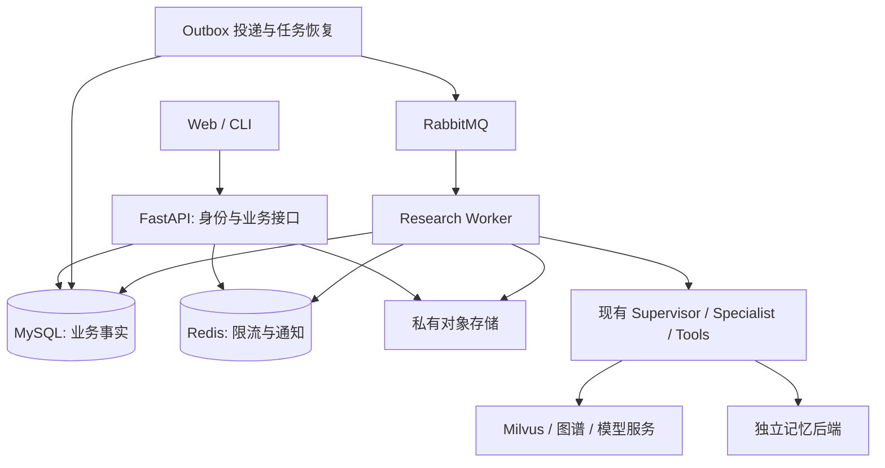

# Research-Copilot 校招项目完整改进方案

日期：2026-11-09

状态：已按方案实施本机核心闭环；逐项实现、验证证据及未完成的外部验收见 [平台验收记录](platform-validation.md)。

定位：面向多用户科研工作流的 Agent 平台。

目标：保留 Agent/RAG 优势，以真实业务闭环补齐后端开发、数据建模、事务一致性、异步任务和故障处理能力，为校招提供可演示、可测试、可解释的工程证据。

## 1. 目标与范围

### 1.1 项目最终需要回答的问题

1. 用户如何完成一次从论文导入到研究报告生成的完整操作？
2. 多个用户同时使用时，业务记录、文件、检索结果和记忆如何隔离？
3. 用户重复提交、消息重复投递、Worker 宕机时，如何避免数据错误？
4. MySQL、对象存储、向量库无法共同提交事务时，如何处理部分成功？
5. 如何证明性能、正确性和恢复能力，而不仅是展示技术栈？

项目同时包含两层：Agent 决定研究步骤；后端负责身份、权限、任务生命周期、可靠执行和数据归属。后端任务重试不能替代 Supervisor 的研究策略重规划。

### 1.2 必须交付

- 注册登录、退出与登录会话撤销；自动创建个人工作区。
- 研究项目、论文库、对话消息、报告、任务的完整生命周期。
- MySQL 业务持久化、版本迁移和旧业务数据迁移。
- 工作区隔离，覆盖 API、Worker、文件、检索、缓存、记忆。
- 可靠异步导入与研究任务：幂等、Outbox、重试、取消、心跳与恢复。
- 私有文件访问、重复导入识别、删除后的立即不可访问。
- SSE 阶段事件重连恢复、历史结果恢复。
- 用户级限额、结构化日志、故障定位与基本管理入口。
- 可复现部署、自动化测试、性能报告、故障演示和项目说明。

### 1.3 明确不进入首期

- 计费、支付、订单、套餐。
- 团队邀请界面、跨工作区共享、细粒度文档 ACL、企业 SSO。
- 微服务拆分、Kubernetes、服务网格、分库分表、自研消息队列。
- 任意 Agent 节点的精确 checkpoint 恢复。
- 无证据的“高并发”“生产级高可用”“恰好一次执行”承诺。
- 重写现有 Agent、重新训练模型，或仅为求职改用另一种后端语言。

## 2. 当前代码基础与缺口

以下判断来自源码静态检查，不代表已运行验证。

| 现有位置 | 当前基础 | 改进要求 |
| --- | --- | --- |
| `apps/api/security.py` | 可选全局 API Key | 用户认证、会话、请求级身份与工作区授权 |
| `apps/api/middleware/rate_limit.py` | 进程内按 IP 限流 | 工作区/用户限流，多 API 实例行为一致 |
| `adapters/storage/base.py` | 业务存储协议 | 用户范围、事务边界、领域 Repository |
| `adapters/storage/sqlite_store.py` | SQLite，消息和论文池聚合 JSON | MySQL 关系建模、消息分页、文档关联 |
| `apps/api/research_runtime.py` | SQLite 分支，否则 JSON | 显式后端工厂，未知配置报错 |
| `services/research/paper_operations.py` | 进程内 `asyncio.create_task` | 独立 Worker、持久任务状态、可靠投递 |
| `services/research/literature_research_service.py` | 业务门面、任务注册、存储目录依赖 | 按职责接入新服务，避免继续扩大门面 |
| `runtime/research/` | Supervisor Graph 与 Worker 上下文 | 增加受信身份、取消、事件与预算接口 |
| `memory/research_memory_gateway.py` | 存在 `local-user` 默认身份 | 服务端模式禁止缺省身份；明确记忆范围 |
| `rag_runtime/checkpoint.py` | 内存 checkpoint | 首期明确按业务阶段恢复，不伪称精确续跑 |
| `web/app/api/files/[...path]/route.ts` | 本地文件读取、公开缓存响应 | 改用授权文件 ID，禁用生产旧入口 |
| `web/src/api.ts` | 本机 API 地址 | 同源代理、认证、统一错误与任务 API |

当前工作区存在未提交的 Agent 整合改动。实施前先确认该批改动的基线并运行相关回归，不覆盖或混入无关修改。

## 3. 产品业务模型

### 3.1 资源层级

```text
User
  └─ Workspace（个人工作区）
      ├─ Project
      │   ├─ ProjectPaper → Paper → DocumentVersion → FileObject
      │   ├─ Conversation → Message
      │   ├─ ResearchTask → Attempt / Stage / Event
      │   └─ Report → ReportVersion
      └─ Workspace limits / settings
```

- User 是认证主体；Workspace 是数据隔离边界；Project 是长期研究主题。
- Task 是一次执行，不再充当项目或论文库的唯一容器。
- Paper 可以只有学术元数据；Document 表示可解析的实际文档，两者不能混为一谈。
- 首期每个用户自动创建个人 Workspace，角色为 owner；成员表预留后续演进，不默认开放协作。
- 从项目移除论文只移除关联；删除工作区文档会影响关联项目，需要前端确认。
- 批量导入支持部分成功，用户只重试失败项。

### 3.2 关键用户流程

1. 注册登录，进入默认工作区，创建研究项目。
2. 上传 PDF 或从检索候选中选择论文，提交导入任务。
3. 查看逐篇下载、解析、索引进度；离开页面后任务继续执行。
4. 对已可用文档发起研究，Supervisor 执行检索、分析和写作。
5. 重连后恢复历史消息和阶段进度，读取已完成报告。
6. 可取消未完成任务、重试失败项、移除论文、删除项目或导出报告。

## 4. 架构与技术决策

采用模块化单体，同一代码库部署 API、任务投递/恢复进程和 Worker。



| 技术 | 明确用途 | 不承担的职责 |
| --- | --- | --- |
| FastAPI | HTTP、认证、授权、业务编排、SSE | 不持有研究任务的唯一运行状态 |
| MySQL + SQLAlchemy + Alembic | 服务端业务数据、事务、迁移 | 不替代向量、图谱或 Agent 记忆 |
| RabbitMQ | 可确认的任务投递 | 不是任务最终状态来源 |
| Redis | 限流、临时通知、经测量后加入的缓存 | 不是任务和报告的唯一存储 |
| MinIO / S3 兼容对象存储 | PDF、图片、解析产物和附件 | 不提供应用权限判断 |
| LangGraph 与现有研究工具 | 研究推理与能力执行 | 不决定租户身份或绕过后端授权 |
| Docker Compose | 可复现本地部署和单机演示 | 不代表集群高可用 |

后端新增网络数据库访问优先采用 SQLAlchemy AsyncEngine 和异步 MySQL 驱动，避免在 async 请求内直接运行同步网络 SQL。原 SQLite/CLI 接口保留兼容适配；同步业务逻辑如暂时保留，应将完整短事务放入有界线程池，同一事务不能跨线程共享连接。

### 4.1 记忆存储的首期约束

MySQL 仅保存业务事实。研究会话记忆、长期记忆、用户画像、论文知识卡片继续由原有记忆接口管理，但必须增加身份作用域。

首期部署一个 Research Worker 进程作为本地 SQLite 记忆写入者：按会话创建独立 MemoryManager/WorkingMemory，数据库写入串行化，禁止共享“当前会话”可变对象。API 不直接读写 Agent 记忆。Worker 重启后从持久记忆和业务快照恢复。

因此首期不宣称支持多主机 Worker 横向扩展。需要扩容时，先将记忆访问替换成独立单写者记忆服务或共享数据库后端，并验证并发更新；这是扩容门槛，不是把 SQLite 放在共享网络盘上即可解决的问题。

## 5. MySQL 数据模型

使用 InnoDB、utf8mb4、UTC 时间、明确长度的字符串 ID；标识符使用大小写敏感比较。JSON 用于复杂内容，不替代关系与可查询状态。

| 表组 | 核心字段与约束 |
| --- | --- |
| `users` | id、规范化登录邮箱（唯一）、password_hash、status、created_at |
| `auth_sessions` | session_id、user_id、token_hash（唯一）、expires_at、revoked_at |
| `workspaces` / `workspace_members` | workspace_id、user_id、role；成员关系唯一 |
| `projects` | workspace_id、project_id、name、status、version |
| `papers` / `project_papers` | 工作区论文元数据、项目关联；关联三元组唯一 |
| `documents` | workspace_id、document_id、paper_id（可空）、status、active_version、deleted_at |
| `document_versions` | version_id、document_id、文件哈希、parser_version、embedding_version、解析与索引状态 |
| `file_objects` | file_id、workspace_id、object_key、sha256、size、mime、status |
| `conversations` / `messages` | conversation_id、project_id；message_id、seq、role、content、task_id |
| `research_tasks` | task_id、workspace_id、user_id、project_id、kind、status、version、input_json、result_ref |
| `task_attempts` | attempt_id、task_id、attempt_no、status、lease_owner、lease_expires_at、execution_epoch、error_code |
| `task_stages` | task_id、scope_key、stage、artifact_ref、input_fingerprint、status；阶段执行键唯一 |
| `task_events` | task_id、event_seq、event_type、payload、created_at；任务内序号唯一 |
| `reports` / `report_versions` | 报告身份、版本内容、来源任务；task_id 与输出键唯一 |
| `outbox_events` | event_id、kind、payload、next_attempt_at、published_at、attempt_count |
| `idempotency_records` | workspace_id、actor_id、operation、key、request_hash、resource_id、expires_at；组合唯一 |
| `audit_events` | actor、workspace、action、resource、request_id、outcome；不存敏感正文 |

所有租户资源带 workspace_id，外键/关联查询同时约束工作区。旧 UUID 格式保留，不为了有序 ID 引入额外系统。

推荐索引围绕真实查询建立：

- 会话列表：`(workspace_id, project_id, updated_at, conversation_id)`。
- 消息翻页：唯一 `(workspace_id, conversation_id, seq)`。
- 任务列表：`(workspace_id, status, created_at, task_id)`。
- 超时恢复：`(status, lease_expires_at)`，只供内部恢复器使用。
- Outbox 扫描：`(published_at, next_attempt_at, event_id)`。
- 项目论文关联：唯一 `(workspace_id, project_id, paper_id)`。

所有列表接口设置最大页大小，消息和事件使用游标分页。用 EXPLAIN 和真实生成的数据集验证，而不是为每个字段建索引。

## 6. 身份、权限与隔离

### 6.1 登录

- Web 同源部署，使用高熵不透明会话令牌；MySQL 仅保存摘要。
- 密码使用成熟库的 Argon2id 哈希，禁止自制加密算法。
- Cookie 设置 HttpOnly、生产 Secure、适当 SameSite；写接口增加 CSRF 防护。
- 登录失败统一响应，限流；退出撤销会话；禁用账号后请求不得继续授权。
- 公网注册前完成邮箱验证和一次性、限时的密码重置流程；本地演示使用测试邮件服务。
- CLI 使用可撤销、限定权限的个人凭证，凭证只在创建时显示一次。

### 6.2 授权契约

`RequestContext` 包含 user_id、workspace_id、role、request_id。workspace_id 即使来自路径，也必须验证成员关系。

- Repository 必须显式绑定作用域，业务查询不能调用未限定范围的通用查询。
- 资源不存在与无权访问统一按资源不可见处理；错误码仍区分未登录与操作权限不足。
- Worker 从持久任务中恢复主体和范围，并在执行前复核账号、成员关系、文档状态。
- Service 单例只共享无状态依赖，不保存 current_user/current_workspace/current_conversation。
- 内部恢复器、迁移器使用独立内部端口，不通过公开 API 提供全库操作。
- 生产禁用匿名旧接口、全局 reset、任意本地路径输入和公开文件路由。

### 6.3 非 MySQL 数据

- 向量查询强制加入 workspace/document scope；返回证据进入 LLM 前重新校验文档有效性。
- 图遍历、图摘要也必须限定来源文档，不能只隔离初始命中。
- 记忆区分 user、workspace/project、conversation 作用域；禁止默认 local-user。
- 缓存键包含作用域和数据版本；权限改变、删除时失效。
- 第三方工具凭据按工作区保存并加密；服务器个人 Zotero 本地库默认不向在线用户开放。
- 同一会话的研究执行首期串行，其他会话可在限额内并发，避免消息顺序和记忆相互覆盖。

## 7. 任务可靠性设计

### 7.1 接受任务

同一 MySQL 事务：验证并发控制条件、创建任务、记录幂等键、写 Outbox。提交成功才返回 202。

幂等键限定为 workspace + actor + operation + key；相同键和相同请求返回原任务，不同请求返回 409。幂等记录首期保留 24 小时；业务唯一约束在记录过期后仍承担防重复责任。

不在该事务内调用模型、下载论文、写向量库。

### 7.2 投递与领取

- 使用持久化队列和持久化消息；投递器获得 publisher confirm 后才标记 Outbox 已投递。
- “发送成功但未标记”可能产生重复投递，因此消费者必须幂等。
- 消费者以条件更新领取任务，创建 attempt/lease，增加 execution_epoch。
- 推荐短消息确认模型：成功领取并持久化后确认消息；长任务可靠性由心跳和恢复器保障，避免消息长期未确认超时。
- Worker 已领取但未启动即宕机，也由租约到期恢复；数据库不可用时不确认领取。
- 消息包含任务 ID 和版本等最少字段；正文和认证令牌不放入队列。
- 消息携带 dispatch_generation，领取时与当前派发代次和 next_run_at 比较，避免迟到旧消息抢跑重试。过期消息确认丢弃，合法待执行任务仍由对应 Outbox 和恢复器保障。
- 领取前先获得本地运行槽位；无空闲时停止消费或暂停领取，不能依靠已经确认消息后的 prefetch 限制并发。数据库任务槽位与本地槽位分别约束用户公平性和进程资源。

### 7.3 状态机

```text
queued → running → succeeded
                 → partially_succeeded（批量任务）
                 → failed
                 → retry_wait → queued
queued → cancelled
running → cancel_requested → cancelled
```

首期默认心跳 10 秒、租约 60 秒、恢复扫描 15 秒，均可配置，需通过 CPU 阻塞和长请求测试调整。使用数据库时间判断租约；CPU 密集解析放到受限子进程，避免阻塞心跳。

任务领取与终态提交都检查 execution_epoch。旧执行者的状态写入必须失败；外部文件和索引产物以 attempt/version 隔离，只有当前执行者可以发布为 active，过期产物由清理任务回收。

### 7.4 重试、取消与副作用

- 瞬态网络错误、可恢复服务错误有限重试，默认最多 3 次、指数退避加抖动。
- 参数错误、权限错误、损坏文件不自动重试。
- 数据库断连导致提交结果未知时，先查业务幂等键/阶段状态，不能直接重放外部调用。
- 取消先持久化请求，阶段边界和模型/工具调用前检查；正在执行的不可取消外部请求只保证不再推进后续阶段。
- 完成和取消竞争通过版本条件更新决定；已经成功的任务不能被迟到的取消覆盖。
- 对下载、解析、索引使用阶段指纹与稳定产物 ID；报告输出设置唯一来源键。
- 对 Zotero 等外部系统能查询的结果先核查，不能确认时标记“需核查”，不伪称恰好一次。
- Outbox 解决任务提交与投递衔接，不保证跨系统原子事务。

### 7.5 研究任务恢复边界

论文导入按下载、解析、索引恢复；研究任务按已提交的研究阶段恢复。现有 LangGraph 内存 checkpoint 不承诺恢复中途推理栈。

若当前阶段不能安全续跑，则创建新 attempt 从该阶段重新执行，携带已提交结果与受限上下文，并明确展示“重试执行”。数据库状态可恢复，不等于 LLM 输出完全可复现。

## 8. 文档、文件与跨存储一致性

### 8.1 上传与去重

1. 创建 upload/file 记录，返回短期上传地址。
2. 上传完成后服务端核验对象存在、大小、内容类型和内容哈希，不能只信客户端声明。
3. 相同 workspace + 文件哈希复用已存在的文件；并发上传由数据库唯一约束收敛，多余对象异步回收。
4. 相同文件在不同项目仅新增关联；不同工作区不暴露去重命中情况。
5. parser_version 或 embedding_version 变化时生成新处理版本，不能错误复用旧索引。

### 8.2 解析与索引发布

文件状态、解析状态、索引状态分别记录；“已上传”不能等同于“可全文问答”。新版本索引完成并校验后才切换 active_version。

MySQL 与对象/向量存储无法共同提交时：先产生带版本的产物，再提交活动版本引用；失败的孤立产物可回收，检索只访问有效版本。对索引超时保留已解析结果，前端显示证据能力限制。

### 8.3 删除

事务内标记 deleted、递增版本并创建清理 Outbox，之后阻止新下载、检索与任务使用；后台删除对象、向量、图谱、缓存和关联记忆。

用户私有文件默认由鉴权下载代理提供。若启用直链签名 URL，需明确撤销延迟最多等于 URL 有效期，不能同时宣称所有已签发链接立即失效。已发送到用户或模型的数据无法追回。

清理失败进入重试，可在管理入口查看；在途阶段提交时复核文档状态，不能让被删除文档重新变为可用。

## 9. Agent 接入契约

保留现有 Supervisor + 四个高层 Specialist，以及现有工具能力，避免同时重构推理算法。

新增只读 `ExecutionContext`：workspace_id、user_id、project_id、conversation_id、task_id、attempt_id、execution_epoch、授权文档范围、预算和取消查询端口。

- Context 在服务端构建，LLM 无权修改身份或扩大文档范围。
- 工具接受受限知识访问端口，不获得数据库全表连接或全局文件路径权限。
- Supervisor 仍负责研究决策；Worker 负责该次执行的租约、事件与结果提交。
- 将现有 progress callback 接到统一 TaskEventSink；最终结果接到事务提交单元。
- 请求输入保存版本与必要参数，工具/模型配置记录版本标识，敏感凭据不存快照。
- 记忆写入在业务结果提交后进行，携带去重事件 ID；记忆失败可重试，不回滚已成功报告。
- 业务快照、派生记忆和运行中 WorkingMemory 职责分开，不能有多个“最终状态真相”。

保持现有 RAG 评测，新增“身份与文档过滤不降低授权范围内证据正确性”的回归；不能为了隔离直接放弃原有研究能力。

## 10. API 与前端调整

新增版本前缀 `/api/v1`，使用统一 request_id、错误码和游标分页。典型接口：

| 接口 | 行为 |
| --- | --- |
| `POST /auth/register`、`POST /auth/login`、`POST /auth/logout` | 身份生命周期 |
| `GET /me`、`GET /workspaces` | 当前身份及授权工作区 |
| `GET/POST /workspaces/{wid}/projects` | 项目管理 |
| `POST /workspaces/{wid}/uploads` | 创建上传授权 |
| `POST /workspaces/{wid}/uploads/{id}/complete` | 校验上传并准备文档 |
| `POST /workspaces/{wid}/projects/{pid}/imports` | 创建批量导入任务，返回 202 |
| `POST /workspaces/{wid}/conversations/{cid}/messages` | 幂等保存用户消息并创建研究任务 |
| `GET /workspaces/{wid}/conversations/{cid}/messages` | 分页消息 |
| `GET /workspaces/{wid}/tasks/{tid}` | 状态和结果引用 |
| `GET /workspaces/{wid}/tasks/{tid}/events` | SSE，可按 Last-Event-ID 恢复 |
| `POST /workspaces/{wid}/tasks/{tid}/cancel`、`.../retry` | 受控取消与重试 |
| `GET /workspaces/{wid}/files/{fid}/content` | 授权文件访问 |
| `DELETE /workspaces/{wid}/documents/{did}` | 逻辑删除并排队清理 |

路径统一以 `/api/v1` 开头；表中省略公共前缀。资源授权必须覆盖完整路径关联，不能只验证 wid。

错误包括未认证 401、操作禁止 403、资源不可见 404、幂等/版本冲突 409、输入不合法 422、限流 429、依赖不可用 503。返回稳定业务错误码，不返回数据库连接串和第三方密钥。

SSE：关键事件先提交 MySQL 再通知 Redis。重连按 seq 补发，实时通知只用于唤醒读取；通知丢失时周期性查询补齐。Token delta 可短暂传输，最终消息持久化；客户端不得将临时 Token 视作已经保存的最终回答。

前端保留现有聊天布局，增加登录、项目切换、论文状态、任务面板、取消/重试、报告版本和错误提示。任务标识从后端恢复，不仅存在浏览器组件状态中。

## 11. 限额、可观测与运行约束

初始可配置演示限额：每用户 2 个运行任务、10 个排队任务、单批 20 篇论文、单文件 50 MiB；这不是经过验证的容量承诺。

- 排队数量检查与任务创建放同一事务，并锁定工作区容量记录，避免并发超卖。
- 运行槽位分配与任务领取原子更新，完成/恢复幂等释放，周期性按有效租约核对占用。
- Redis 请求限流不可用时，昂贵任务提交保守拒绝或进入受数据库限额约束的降级路径；不无限放行。
- RabbitMQ prefetch 与 Worker 本地并发有界；同一会话串行，避免无界创建 asyncio Task。
- 外部调用设置总任务期限、阶段期限和有限重试；模型/工具限流时明确记录等待原因。

结构化日志关联 request/workspace/task/attempt；不默认记录论文全文、密码、令牌和用户消息正文。指标包括 API 延迟、队列年龄、任务成功率、重试、租约超时、数据库连接池等待与模型超时。

管理入口首期支持查看任务、错误和阶段、取消任务、受控重试、禁用账号。管理员操作留审计记录，不直接开放任意 SQL 或内容读取。

## 12. 代码改造地图

以下为拟新增路径，实施时保持小模块职责；不是已存在能力。

| 路径 | 职责 |
| --- | --- |
| `domain/schemas/identity.py`、`task_execution.py` | 受信身份、执行状态与事件契约 |
| `services/identity/` | 登录、会话、工作区成员授权 |
| `services/projects/` | 项目和资源生命周期 |
| `services/task_execution/` | 提交、领取、状态转换、取消、恢复 |
| `adapters/storage/mysql/` | 连接、表定义、Repository、UnitOfWork |
| `adapters/storage/mysql/migrations/` | Alembic schema 版本 |
| `adapters/queue/rabbitmq.py` | 投递确认、消费与连接恢复 |
| `adapters/object_store/` | 文件上传、读取、删除接口 |
| `apps/worker/` | 领取任务、运行 Agent、心跳与阶段提交 |
| `apps/scheduler/` | Outbox 投递、租约回收、清理与对账 |
| `apps/api/routers/auth.py`、`projects.py`、`tasks.py`、`files.py` | 新业务接口 |
| `runtime/research/worker_task_input.py`、`context_builder.py` | 注入受信作用域，避免序列化完整服务句柄 |
| `memory/research_memory_gateway.py` | 移除在线默认身份、限定记忆范围 |
| `scripts/migrate_business_to_mysql.py` | 旧业务迁移、dry-run、核对报告 |
| `tests/contract/storage/`、`tests/integration/backend/` | 存储契约与真实依赖集成 |
| `tests/e2e/`、`benchmarks/backend/` | 用户流程、故障和性能证据 |

现有 `report_service.storage_root` 被图表缓存、偏好流程、观测等模块使用。必须抽出 ArtifactStore/运行产物目录配置，不能假设换成 MySQLStore 后仍有本地业务根目录。临时解析目录可以保留，但不再是共享业务产物的唯一来源。

## 13. 数据迁移与兼容

1. 确认旧工作区代码和数据基线，备份 SQLite、文件目录与检索版本信息。
2. 在独立 MySQL 数据库执行 schema migration，迁移工具默认 dry-run。
3. 指定一个历史数据所有者，创建个人工作区与“历史研究”项目。
4. 保留原任务、会话、消息、论文和报告 ID；展开消息/论文数组并保存稳定顺序。
5. 为旧文件建立 FileObject 映射，复制到对象存储并核验哈希；未找到文件明确列为不可用。
6. 为已有向量/图数据补作用域或重建索引；无法证明来源归属的数据不向在线用户暴露。
7. 旧记忆仍留在原后端，显式映射给历史所有者；不可自动成为所有用户共享记忆。
8. 按数量、ID 集合、内容摘要、关联完整性验证；重复运行不覆盖目标新数据。
9. 停写窗口完成最终迁移和切换；新旧模式不能同时写同一逻辑资源。

旧 API 兼容只用于受控开发迁移，不可在生产形成匿名旁路。新的 CLI 通过服务 API 操作在线数据，本地离线模式独立配置。

切换前可回退旧库；切换后有新写入时，需增量迁回或恢复新库，不能仅改配置。原 SQLite 仍承载记忆时不得删除。

## 14. 实施阶段与退出标准

实施前将各阶段细化为独立实施计划；本文是总体设计，不包含全部逐函数代码。顺序由数据和可靠性依赖决定，不按中间件逐个堆叠。

### M0：基线与契约

- 确认现有 Agent 整合改动，保存原有测试和评测基线。
- 明确身份上下文、资源归属、任务状态、错误码、存储分工。
- 产出 ER 图、状态机、架构决策记录和可运行旧版说明。
- 退出标准：已有研究链路可演示；新旧能力清单明确，不把计划当成果。

### M1：多用户业务纵向闭环

- 注册登录、个人工作区、项目、MySQL Repository 与迁移。
- 私有上传/下载、文档归属、消息分页；生产旧路由关闭。
- 所有新数据绑定工作区，原记忆与检索先完成隔离再接在线 Agent。
- 退出标准：用户 A、B 能独立管理项目，互换所有资源 ID 均不能越权。

### M2：可靠论文导入

- Task/Attempt/Stage/Event、Outbox、RabbitMQ、独立 Worker。
- 下载→解析→索引、幂等、租约、阶段重试、并发配额。
- 退出标准：重复提交只产生一个逻辑导入；杀 Worker、停队列后任务可恢复；批量部分失败可单项重试。

### M3：在线 Agent 与业务一致性

- 接入现有 Supervisor；注入受信上下文、预算、取消和事件端口。
- 对话历史、报告版本、SSE 重连、文档删除和产物清理。
- 退出标准：两个用户可完整研究；刷新/离线不丢任务；删除论文后新检索不能获得其证据。

### M4：服务治理与交付证据

- 限流、结构化日志、指标、基本管理入口、部署与恢复脚本。
- 数据迁移演练、故障注入、数据库优化与性能测试。
- 邀请少量真实使用者完成任务，记录问题并修复，不虚构用户规模。
- 退出标准：能从空环境启动、导入示例数据、演示故障恢复并复现测试报告。

按里程碑验收推进，不预设未经评估的工期；M0 后根据可投入时间、现有测试和迁移难度估算。时间不足时先完成 M1–M3 的完整闭环，再扩展管理界面和缓存。

## 15. 验证矩阵

| 场景 | 必须断言 |
| --- | --- |
| A 请求 B 的任务、文档、文件、报告 | 不返回内容，不泄露存在性，不触发操作 |
| A 检索 B 的独有关键词 | 证据、摘要、图谱和缓存都不出现 B 内容 |
| 多次提交同一幂等键 | 返回同一任务；不同请求内容产生冲突 |
| DB 提交后、消息发送前崩溃 | Outbox 恢复投递，任务最终可执行 |
| 消息发送后、Outbox 标记前崩溃 | 可重复投递，但不产生重复逻辑结果 |
| Worker 领取后立即被终止 | 租约到期回收，无永久 running |
| 旧 Worker 在重试启动后恢复 | 旧 epoch 不可提交状态或发布 active 产物 |
| 解析完成、索引失败 | 保留解析产物，只重试需要的阶段 |
| 取消与完成并发 | 只有一个合法终态，不被迟到事件覆盖 |
| 上传同一文件并发完成 | 工作区内唯一资源归属，无双重发布 |
| 删除与检索并发 | 业务标记生效后新证据组装不再使用文档 |
| SSE 断开后重连 | 阶段事件按序恢复，客户端可去重 |
| Redis 通知丢失 | 任务状态仍可从 MySQL 恢复 |
| 配额并发竞争 | 不超过已定义运行/排队限制，不泄漏槽位 |
| 迁移重复运行 | 不重复插入，不覆盖目标新增数据 |
| 备份恢复 | 业务关联、文件引用和可用索引版本可核对 |

集成测试使用真实 MySQL/RabbitMQ/对象存储，Mock 仅隔离付费或不稳定外部模型。权限、事务与队列测试不能全部以 Mock 代替。

## 16. 性能评估与证据

先建立基线，再优化；不预设漂亮指标。

- 数据规模：生成 10 万条消息、1 万条文档元数据和 1 万条任务记录作为可复现测试档位；标明合成数据。
- API 场景：消息分页、项目文档列表、任务提交、状态查询，逐档提升并发。
- 记录 P50/P95/P99、吞吐、错误率、数据库连接池等待、CPU/内存和查询计划。
- 用固定延迟模型替身测调度承载；真实模型另测少量端到端任务，不混用两种结论。
- 故障测试记录注入时点、恢复条件、恢复时间、重复结果数和异常终态数。
- 若加入缓存，展示缓存命中率、前后延迟和失效正确性；没有明确瓶颈就不加入。
- 检索质量继续沿用原评测框架，任何性能优化同时检查授权范围内回答质量。

报告必须列硬件、依赖版本、并发配置、数据规模、Mock 范围、命令及原始输出位置。不能把压测并发写成真实用户数，不能把演示部署写成生产 SLA。

## 17. 求职交付物与简历呈现

最终仓库应包含：

1. 一页产品说明、架构图、ER 图和任务状态机。
2. 一条可从空环境执行的部署路径，配置模板不含密钥。
3. 5–8 分钟演示：双用户隔离、导入、研究、断线重连、故障重试。
4. 存储/权限/可靠性测试与性能报告。
5. 三篇技术复盘：事务 Outbox 与幂等；文档跨存储一致性；Agent 多用户上下文隔离。
6. 真实问题记录：症状、复现、根因、修复与验证，保留取舍和限制。

简历保持两条 Agent/RAG 与两条后端：

- Agent：Supervisor 决策、专业 Agent、工具与上下文边界。
- RAG：文档处理、混合检索、评测结果。
- 业务后端：多用户工作区、MySQL 模型、授权和文档生命周期。
- 可靠执行：Outbox、消息队列、幂等、阶段恢复，附真实验证结果。

描述必须在实现后据实填写；保留现有评测指标的证据，不将计划功能写成已完成。项目时间覆盖实际新增开发期。

面试必须能独立解释：为什么数据库事务不能包住下载与模型调用；为什么队列确认不等于业务恰好一次；为什么删除后需要二次权限过滤；为什么 API 多实例不等于 Worker 可以无条件扩容；为什么不引入微服务。

## 18. 已确定决策与风险

- 首期个人工作区，未来团队能力不阻塞当前交付。
- MySQL 只保存业务服务端数据；记忆不迁入 MySQL，但隔离必须改。
- API 与 Worker 分离，先单 Worker 进程完成可靠性，扩容前解决记忆共享。
- 业务阶段恢复优先于任意 LangGraph 节点恢复。
- 保留现有 Agent 主线，不在业务改造中更换推理架构。
- 当前存储与本地目录耦合、默认 local-user、全局可变记忆是优先排查风险。
- 旧数据迁移、外部副作用结果未知、图谱来源过滤是需要专项测试的边界。
- 不承诺先前提及的高可用数字；部署能力与恢复目标必须经过演练后记录。

## 19. 设计参考

- OWASP 多租户安全：https://cheatsheetseries.owasp.org/cheatsheets/Multi_Tenant_Security_Cheat_Sheet.html
- OWASP 授权：https://cheatsheetseries.owasp.org/cheatsheets/Authorization_Cheat_Sheet.html
- MySQL 时间点恢复：https://dev.mysql.com/doc/refman/8.4/en/point-in-time-recovery.html
- RabbitMQ 消费确认与发布确认：https://www.rabbitmq.com/docs/confirms
- SQLAlchemy asyncio：https://docs.sqlalchemy.org/en/20/orm/extensions/asyncio.html

参考用于校验机制与限制；具体依赖版本在实施阶段固定并完成兼容测试。
