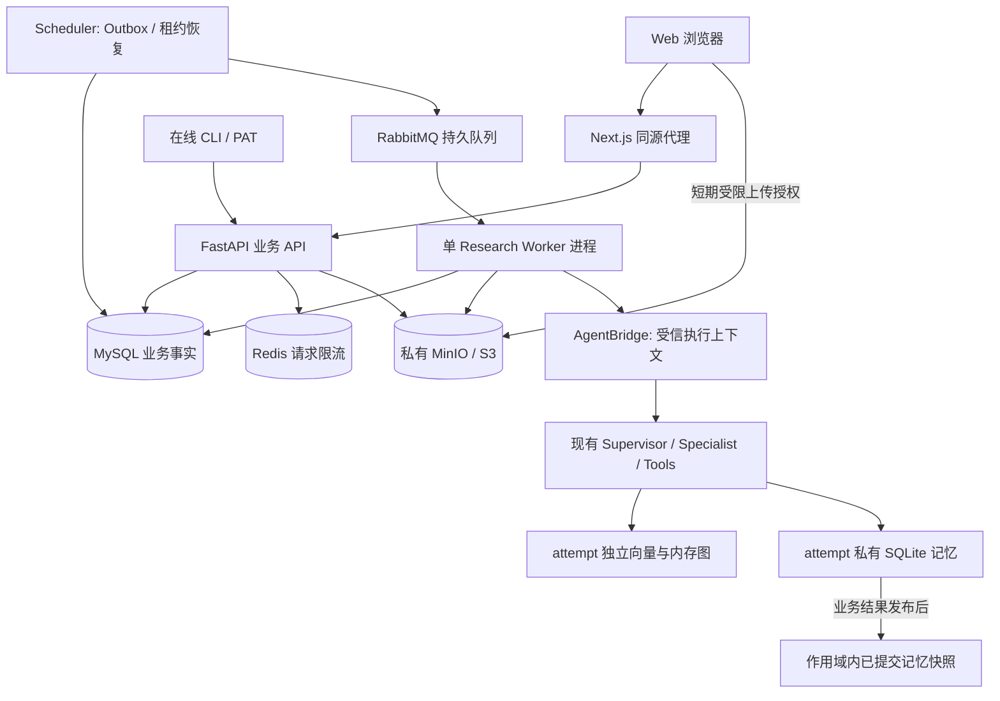
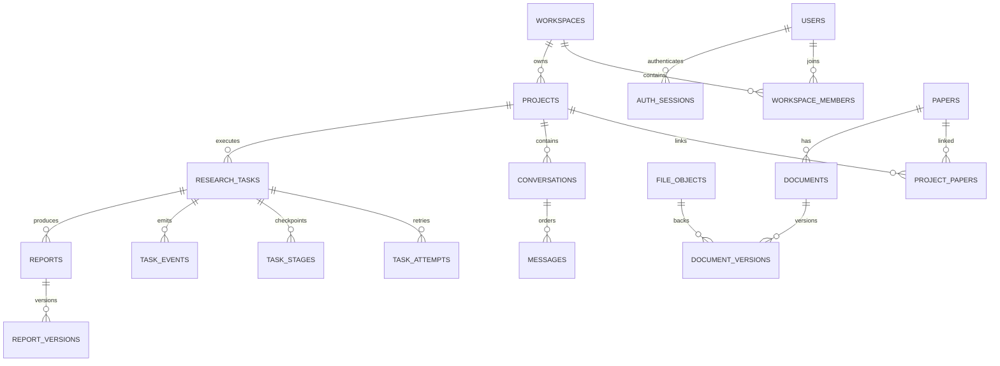
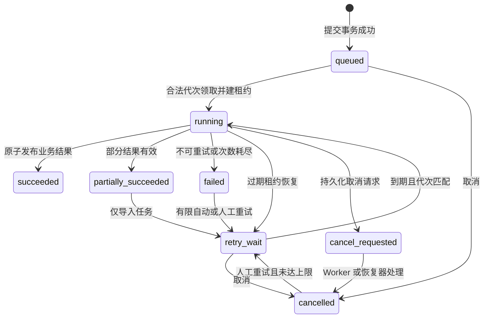

# 多用户研究平台：业务与架构

本文描述当前实现，原始需求见[完整改进方案](Research-Copilot校招项目完整改进方案.md)，运行方式见[运行手册](platform-runbook.md)，实测结果以[验证记录](platform-validation.md)为准。

Research-Copilot 为用户提供“创建研究项目 → 上传或导入论文 → 解析和索引 → 与 Agent 研究 → 保存对话和报告”的工作流。Agent 仍负责研究决策，业务后端负责身份、资源归属、执行可靠性和结果发布。首期个人工作区、不含计费，也没有开放团队邀请和跨工作区共享。

## 进程与存储

| 模块 | 当前职责与约束 |
| --- | --- |
| `apps/platform/main.py` | 新 `/api/v1` 入口、Cookie/PAT 认证、CSRF、工作区授权、SSE、管理接口 |
| `services/identity`、`services/projects` | 账户/成员检查、项目乐观版本控制；删除项目取消排队任务并请求运行任务取消 |
| `services/platform` | 文件、论文、对话、报告、上传授权、Agent 桥接、记忆发布与对象对账 |
| `services/task_execution` | 任务提交、配额、幂等、领取、租约、阶段和事件 |
| `apps/scheduler` | 当前每秒扫描一次：过期上传清理、租约恢复、Outbox 投递、幂等记录清理 |
| `apps/worker` | 有界执行、心跳、PDF 子进程、Agent 调用及发布 |
| MySQL | 业务事实与可恢复任务状态；不存向量索引或 Agent 记忆 |
| Redis | 当前用于身份相关请求限流；SSE 实际直接轮询 MySQL，不依赖 Redis 通知 |
| MinIO/S3 | 原始 PDF、解析 JSON、任务结果对象；私有下载经 API 授权 |
| 本地 Worker 目录 | attempt 临时产物与独立记忆快照，需纳入备份 |

首期部署一个 Worker 进程，默认本地运行槽位为 2；同会话执行与记忆发布串行。API 可以无状态部署，但这不能推出 Worker 已支持跨主机扩容。扩容前需独立记忆写入服务、共享产物策略及多 Worker 并发验证。

## 核心关系模型

下面只展示业务主干。每个租户资源携带 `workspace_id`，主要关联使用带工作区的复合外键；图中的连线不表示跨表操作天然处于同一事务。

- Paper 可以只有元数据；Document 才表示可处理的文档。项目移除论文只解除关联，删除工作区文档会影响所有关联项目。
- `documents.active_version` 发布后才代表可用于研究的版本；复合约束确保活动版本属于该文档。解析成功不代表索引成功。
- `messages` 的 `(workspace_id, conversation_id, seq)` 唯一，消息和事件均按序号翻页。
- `task_stages` 按任务、文档范围、阶段和输入指纹唯一；`reports` 按任务与输出键唯一。
- `idempotency_records` 的作用域是工作区、操作者、操作和键；`outbox_events` 保存已提交的派发意图。它们以资源 ID/消息内容关联任务，不画成不存在的数据库外键。
- 额外表覆盖邮箱令牌、个人凭证、上传会话和管理审计。准确 DDL 见 `adapters/storage/mysql/tables.py` 与 Alembic migrations。

## 任务状态与事务边界

实现中 `retry_wait` 到期可直接领取成 `running`，无需中间改回 `queued`。自动重试默认总 attempt 上限为 3；代次 `generation` 防迟到队列消息，执行纪元 `execution_epoch` 防旧 Worker 提交。默认租约 60 秒，心跳为租约的三分之一；这些是参数默认值，不是恢复 SLA。

提交事务同时写任务、幂等记录、Outbox，研究消息也在此保存。下载、PDF 解析、索引和模型调用在事务外进行。研究结果发布事务再次核验租约、纪元、主体权限、项目和文档版本，再写助手消息、报告版本、任务终态和事件。对象可先存在，但在发布成功前不能成为授权业务结果。

## 身份与 Agent 边界

`RequestContext` 从会话或 PAT 解析，路径中的工作区必须检查成员关系。Worker 从数据库恢复任务身份；模型工具参数不能替换用户或扩大文档集合。冻结的 `ExecutionContext` 当前包含 user/workspace/project/conversation/task、epoch、授权文档元组和总超时。独立 attempt ID 在数据库记录；取消与权限复核通过 Worker/检索包装器完成，未作为 Context 内的服务句柄暴露。

AgentBridge 为每次执行建立独立目录、向量集合名和内存图，只从授权活动版本重建检索上下文。`ScopedRetriever` 校验请求子集、返回命中、证据及嵌套图谱来源的文档 ID，并在检索前后复核业务权限。个人 Zotero、本地代码执行和全局 MCP 在在线桥接中关闭。公网论文下载限定经过校验的 arXiv ID，不接受任意 URL。

记忆按用户、工作区、项目、会话和文档版本划分作用域。attempt 先写私有 SQLite；只有对应业务结果成功发布且权限、版本仍有效，才推进已提交快照。旧 `local-user` 不作为在线身份。

## 验证与部署边界

目前研究链路集成测试使用真实 MySQL/对象存储、真实 PDF 解析与 Supervisor，但模型、embedding、向量检索使用本地确定性/memory provider；图强制使用 attempt 内存图。它能证明业务接入和隔离机制，不能证明真实模型研究质量、线上 Milvus 性能或高可用。

向量集合属于 attempt，结束时清理，下次研究从解析产物重建；`index_status=succeeded` 表示处理曾成功，不能解释为永久在线的共享向量集合。进程异常退出后的遗留集合、旧本地产物需要进一步运维清理。解析图像的本地路径还需单独验证跨根目录恢复，不能只凭数据库备份一致就宣布完整多模态恢复。

TLS、真实邮件服务、真实用户试用和生产容量评估属于外部部署验收。当前文档与测试没有把本地演示称为生产 SLA。
